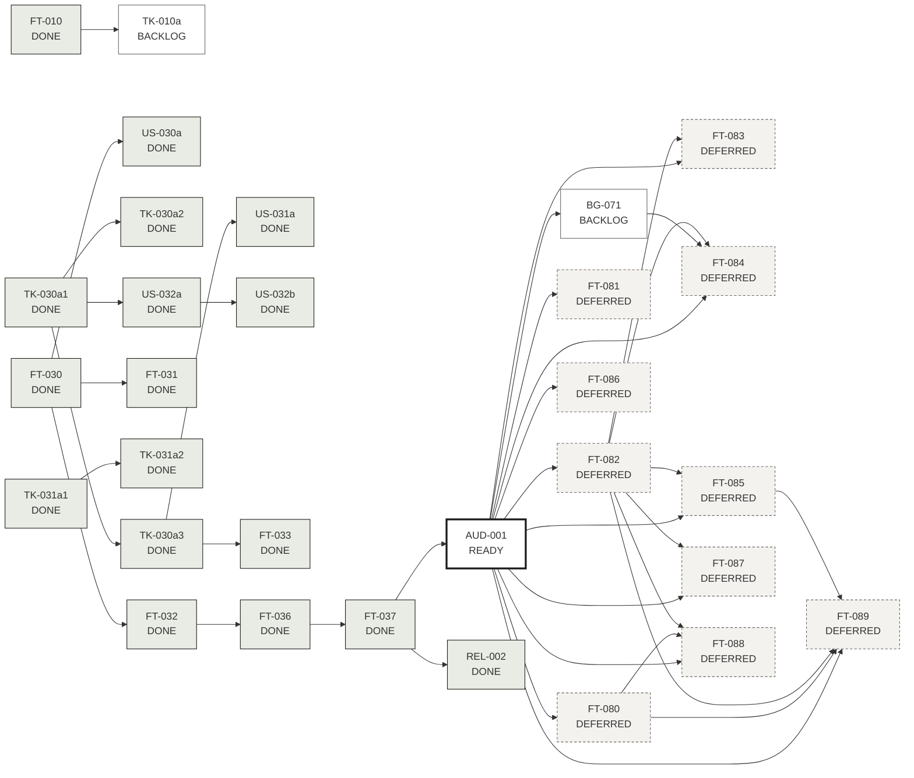

# Grafo de dependências

## Caminho crítico até a integração com o Supabase
1. `FT-037` (revelação validada no preview) → 2. **`AUD-001`** (auditoria independente, P0) → 3. `REL-001` (confirmar/promover destino; não bloqueia o Supabase, bloqueia produção) → 4. `BG-071` (outbox) → 5. `FT-080` Auth e `FT-082` Esquema/RLS → 6. `FT-085` Storage e URLs assinadas → 7. `FT-083` revelação no servidor e `FT-084` realtime → 8. `FT-089` migração local → nuvem.

Tudo em EP-09 está DEFERRED até o release gate passar.
