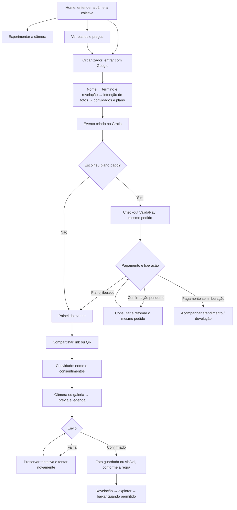

# MemoriesMT — melhorias de fluxo e design

Guia de decisão · 06/11/2026 (America/Sao_Paulo) · Base: auditoria de 06/11/2026, 25 achados (6 P1, 17 P2, 2 P3).

O maior ganho é fazer a pessoa entender **o que vai acontecer, o que já aconteceu e como continuar quando algo falhar**. A identidade visual já oferece uma base consistente: câmera coletiva, contraste forte, superfícies claras, formas arredondadas e linguagem próxima. O trabalho deve concentrar essa identidade nas decisões da jornada.

## Como ler este guia

- **Lote A01–A25:** problemas encontrados na auditoria e comportamento esperado de sua correção. Esta lista é um mapa de escopo, não uma declaração de implementação, publicação ou homologação. A entrega técnica deve registrar os testes e eventuais pendências de cada ID.
- **Tratamento autorizado de A01:** retirar da oferta produtiva apenas o plano de homologação identificado por código `teste1real`, preço de 100 centavos e nome de teste, preservando plano, pedidos e direitos existentes. Os preços e planos comerciais permanecem preservados.
- **Evolução futura:** propostas de reorganização ou funcionalidades além dos achados. Os mockups são ilustrativos e não significam que essas telas foram implementadas.

Mantêm-se MemoriesMT, a stack atual, os planos comerciais e o checkout ValidaPay. Os documentos antigos `identidade.md` e `PAGAMENTO-MOBILE-NATIVO.md` contêm propostas históricas de marca e de Mercado Pago; não devem substituir a marca e a jornada vigentes. Pedidos legados podem conservar sua identificação real de provedor.

## 1. Jornada que a pessoa precisa compreender

A revelação tem duas perguntas independentes: **quando** a foto aparece e **quem** pode vê-la. Convite, câmera, sucesso, painel e ajuda precisam responder às duas da mesma forma. Um evento com acesso restrito não pode prometer um álbum visível para todos.

## 2. Melhorias por área

### Home, exemplo e preços

**No lote — A22, A24, A25:** tornar “Ver planos e preços” acessível em uma ação a partir da home; descrever ValidaPay de forma consistente; permitir repetir o Google mantendo o destino original. A pessoa que só quer participar continua com uma entrada explícita por código.

**Por quê:** descobrir o preço depois de começar o cadastro gera insegurança; repetir uma tarefa após falha sem perder o destino reduz abandono.

**Hierarquia recomendada:** promessa do produto → explicação curta → ação principal “Criar meu evento grátis” → ações secundárias “Experimentar câmera”, “Ver planos e preços” e “Entrar com código”. A demo continua dizendo que nada é salvo. Alterar a ordem visual de blocos ou reduzir a altura da ilustração é evolução futura, a validar no celular.

**A01 — decisão do lote:** retirar da oferta produtiva somente o plano de homologação identificado pela combinação `teste1real` + 100 centavos + nome de teste. O plano e seus pedidos/direitos existentes permanecem preservados. A comunicação de menor preço deve refletir o catálogo comercial disponível, sem inventar desconto, prazo ou mudar valores comerciais. Esta decisão não constitui prova de execução ou publicação.

### Criação do evento

**No lote — A06, A08, A23, A24:** validar data e horário antes de avançar; preservar dados quando a criação falhar; distinguir a quantidade de fotos desejada do limite efetivo do evento e da compra; recuperar login para a mesma tarefa.

A etapa “Fotos” precisa explicar a escolha: “Quantas fotos você pretende oferecer por pessoa?” O resumo diferencia **limite atual no Grátis**, **plano escolhido** e **limite após a confirmação e liberação**. A escolha não pode parecer uma configuração aplicada se for apenas uma intenção. Os valores devem vir do catálogo vigente.

**Por quê:** a pessoa precisa reconhecer suas escolhas no resultado. Um botão ocupado indefinidamente ou um horário silenciosamente substituído destrói essa previsibilidade.

**Evolução futura:** exibir uma revisão compacta antes da criação, com nome, término, revelação, público e limites, todos com “Editar”. Hoje o evento inicia ao ser criado; agendar início exige uma regra nova, persistência e estados “Agendado/Ao vivo/Encerrado”. Não apresentar esse agendamento como parte do lote.

### Plano, checkout e retorno

**No lote — A09–A13, A22:** uma única mensagem principal por estado; resumo do pedido realmente retomado; consulta acessível quando uma cobrança está incerta; recuperação de falha de carregamento; distinção entre pagamento recebido e plano liberado.

**Hierarquia:** nome do evento → plano e valor do pedido → método → estado atual → próxima ação. Pix precisa de código para copiar no mesmo celular, além do QR. O texto explica a confirmação sem prometer liberação por clique, por retorno de URL ou por comprovante do usuário.

| Situação real | Mensagem principal sugerida | Ação principal |
|---|---|---|
| Checkout ainda não carregou | Não conseguimos carregar o pagamento. | Tentar novamente |
| Pedido aberto retomado | Você tem um pedido em andamento para este evento. | Continuar este pedido |
| Cobrança incerta | Estamos verificando este pagamento. | Consultar pagamento |
| Pix pendente | Aguardando a confirmação do Pix. | Copiar código Pix / consultar |
| Pagamento confirmado e direito liberado | Pagamento confirmado. Seu plano está liberado. | Ir para o painel |
| Pagamento recebido sem direito liberado | Recebemos o pagamento, mas o plano não foi liberado. | Acompanhar atendimento |
| Devolução necessária, ainda não concluída | A devolução precisa ser acompanhada pelo atendimento. | Ver orientação de atendimento |

**Por quê:** “pago” e “ativo” são resultados diferentes. A interface deve impedir que uma mensagem antiga de erro incentive um segundo pagamento depois da confirmação. Não prometer reembolso concluído ou prazo de liberação sem informação confirmada.

### Entrada e fotos do convidado

**No lote — A02–A04, A07, A14, A20, A21:** nome em branco deve gerar erro no campo; falha de conexão não deve virar “código inválido”; câmera ocupada deve ter orientação própria; prévia e legenda devem ser protegidas; pedido de remoção precisa ser registrado e confirmado.

**Sequência:** identificar evento → informar nome e consentimentos → fotografar/escolher → conferir → enviar → receber confirmação. O sucesso precisa dizer se a foto foi enviada, quando ficará disponível e para quem. “Guardada” não pode ser usada para uma tentativa que só existe no aparelho.

**Estados de envio:** prévia → enviando → enviado; falha → tentar novamente ou descartar conscientemente. O rascunho local fica isolado por evento e identidade, com validade de 24 horas, limpeza após envio confirmado/descarte e aviso se a persistência falhar. Descartar uma tentativa incerta apaga apenas o rascunho deste aparelho: a foto pode já ter sido publicada. Sem Navigation API, Voltar/Avançar segue o navegador e o rascunho persistido permite retomar. Não prometer armazenamento indefinido nem que apagar dados do navegador preservará o rascunho.

**Por quê:** a foto pode ser irrepetível. A recuperação faz parte da experiência principal de uma festa, onde sinal e câmera variam.

### Painel do organizador

**No lote — A05, A14–A16, A18–A20:** bloqueio coerente com sua promessa e possibilidade de desbloqueio; erro de leitura com nova tentativa; resultado completo/parcial do ZIP; botão recuperável após falha; confirmação de encerramento com consequência real para a revelação; foco inicial seguro em diálogos; público da revelação coerente com a configuração.

**Evolução futura de hierarquia:** acima dos números, apresentar nome do evento, estado, término e revelação; em seguida, a próxima tarefa útil. Com zero fotos, “Compartilhar convite” e “Testar como convidado” têm mais valor que quatro métricas zeradas. Durante o evento, priorizar capacidade e moderação; depois, acesso ao álbum e downloads.

**Evolução futura de navegação:** reduzir a dependência da faixa horizontal de nove seções no celular. Avaliar agrupamento em “Visão geral”, “Fotos”, “Convidados” e “Mais”, mantendo rótulos visíveis e acesso a “Convite e QR”, “Plano”, “Aparência” e “Configurações”. Testar descoberta antes de mudar as rotas. “QR Code Studio” pode receber o apoio textual “Convite e QR” para explicar a tarefa.

**Por quê:** o painel deve ajudar a agir; números e opções administrativas ganham sentido depois que a próxima tarefa está clara.

### Master e operação

**No lote — A17:** listas com paginação ou busca no servidor; totais e pendências independentes da página carregada; indicar quando o recorte é parcial. Não apresentar “nenhuma pendência” apenas porque ela não está nos primeiros registros.

**Evolução futura:** priorizar filas de ação — pagamentos que exigem atenção, revelações pendentes, denúncias — antes de estatísticas gerais. Distinguir pendência real de falha de consulta.

**Por quê:** uma lista incompleta com aparência de completa induz decisões erradas. Operação precisa de cobertura e estado verificável.

## 3. Antes e depois: texto e comportamento

“Antes” sintetiza o comportamento auditado; “depois” é texto sugerido, sujeito ao estado real e à terminologia final da implementação.

| Contexto | Antes auditado | Depois sugerido | Condição necessária |
|---|---|---|---|
| Outra data | Avança vazio e usa seis horas | “Escolha a data e o horário de término para continuar.” | Manter o passo; erro associado ao campo; foco no erro |
| Nome do convidado | “Entrando…” preso após espaços | “Digite seu nome para entrar no evento.” | Validar nome sem espaços; permitir corrigir e reenviar |
| Escolha de fotos | Escolha aparenta mudar o limite do Grátis | “Essa quantidade ajuda a escolher um plano. Confira abaixo o limite que ficará ativo.” | Exibir limite real e condições de liberação |
| Falha de criação | Botão ocupado sem saída | “Não conseguimos criar o evento. Seus campos continuam aqui.” | Preservar formulário; permitir nova tentativa |
| Erro de leitura | “Não achamos este evento” | “Não conseguimos carregar o evento. Tente novamente.” | Usar somente em falha de consulta, sem ocultar inexistência confirmada |
| Envio interrompido | “Enviando…” sem recuperação | “O envio não foi concluído. Tente novamente.” | Preservar tentativa; afirmar “rascunho salvo” só após persistência confirmada |
| Câmera ocupada | “Permissão negada” | “A câmera pode estar em uso. Feche o outro app ou escolha uma foto.” | Diferenciar erro de acesso, hardware e falha temporária |
| Pedido de remoção | Ação sem registro correto | “Pedido enviado para análise do organizador.” | Mostrar sucesso só após registro; erro com nova tentativa |
| Cobrança incerta | Reenvio sem consulta acessível | “Estamos verificando este pagamento. Consulte o pedido antes de continuar.” | Reconsultar o mesmo pedido; respeitar bloqueio de abandono |
| Pago e liberado | Sucesso e “tente novamente” juntos | “Pagamento confirmado. Seu plano está liberado.” | Direito confirmado; limpar erro antigo |
| ZIP parcial | Diz apenas quantas fotos baixou | “Download parcial: 18 fotos incluídas; 2 indisponíveis.” | Números reais; oferecer nova tentativa sem alegar álbum completo |
| Encerrar evento | Diz que revelação seguirá horário, apesar de mudar | “Ao encerrar agora, as fotos serão reveladas agora.” | Apenas quando a revelação estiver vinculada ao fim sem atraso; demais regras mostram seu resultado calculado |
| Privacidade | “Todos veem” apesar da restrição | “Após a revelação, cada pessoa vê suas próprias fotos e o organizador vê as fotos do evento, conforme a configuração.” | Derivar o público da regra real; informar o momento aplicável |

## 4. Padrões visuais e de interação

1. **Uma ação principal por momento.** O botão cheio conduz a próxima tarefa; ações alternativas usam borda ou link. Uma ação perigosa não ocupa o lugar da ação cotidiana.
2. **Informação próxima à decisão.** Erro ao lado do campo; público e revelação perto do envio; preço e limite perto do pagamento. Evitar concentrar explicações em um rodapé distante.
3. **Estado com texto e ação.** Carregando, vazio, erro, parcial e concluído são distintos. Ícone e cor apoiam o texto; não o substituem. Não usar verde para uma entrega parcial.
4. **Consistência sem redesenho de marca.** Reusar os componentes, tokens, temas Dia/Noite e tipografia atuais. As propostas antigas de nome/paleta não definem uma nova identidade para este trabalho.
5. **Celular e teclado.** Alvos de toque de pelo menos 44 × 44 px; campos de pelo menos 16 px; foco visível; mensagens associadas aos campos; diálogos com foco inicial seguro e retorno ao acionador. Barra fixa, se usada futuramente, deve respeitar área segura e não cobrir conteúdo ou teclado.
6. **Datas completas.** Mostrar dia, horário e fuso do evento onde afetam a decisão. Uma contagem regressiva complementa a data; não a substitui.

## 5. Ordem de prioridade e rastreabilidade dos 25 itens

A ordem abaixo é a recomendação de execução, conservando a prioridade original de cada achado. P1 não significa que ocorreu um incidente. A01 tem tratamento delimitado para o plano de homologação; A21 ainda precisa de prova em aparelhos físicos.

| Ordem | IDs | Prioridade original | Resultado esperado |
|---|---|---|---|
| 1. Preservar fotos e recuperação | A02, A03 | P1 | Tentativa recuperável; rascunho protegido; sem envio preso |
| 1. Moderação coerente | A04, A05 | P1 | Denúncia registrada e bloqueio efetivo por identidade/evento |
| 1. Criação recuperável | A06 | P1 | Falhas devolvem controle sem perder os campos |
| 1. Oferta pública coerente | A01 | P1 | Plano de homologação identificado retirado da oferta produtiva; preços comerciais e direitos existentes preservados |
| 2. Dinheiro e liberação | A09, A10, A11, A12, A13 | P2 | Mesmo pedido; resumo consistente; pago distinguido de liberado |
| 2. Entrada e configuração | A07, A08 | P2 | Nome e data inválidos não avançam nem prendem a tela |
| 2. Conexão e exportação | A14, A15, A16 | P2 | Erro recuperável e resultado de download honesto |
| 2. Operação completa | A17 | P2 | Registros e pendências não somem no limite de uma lista |
| 2. Ações sensíveis | A18, A19 | P2 | Consequência correta e foco seguro ao confirmar |
| 2. Expectativas consistentes | A20, A21, A22, A23 | P2 | Público, câmera, provedor e limites explicados corretamente |
| 3. Descoberta e retomada | A24, A25 | P3 | Retomar login e encontrar preços sem reconstruir o caminho |

## 6. Evoluções futuras — não implementadas por este guia

| Proposta | Ganho esperado | Dependência / como validar |
|---|---|---|
| Agendar início do evento | Preparar e compartilhar convite antes de aceitar fotos | Definir horário/fuso, estados e regra de entrada; testar antes/durante/depois |
| Resumo editável antes de criar | Conferir término, revelação, público e limites | Teste de compreensão com novos organizadores |
| Painel orientado à próxima tarefa | Encontrar convite, moderação e álbum com menos procura | Comparar conclusão de tarefas no layout atual e no protótipo |
| Navegação móvel agrupada | Expor tarefas hoje escondidas pela rolagem horizontal | Teste de descoberta; preservar rótulos e atalhos conhecidos |
| Estado de configuração do evento | Mostrar o que falta preparar sem confundir com evento agendado | Definir checklist real; não inferir prontidão a partir de métricas zeradas |
| Instrumentação de jornada | Medir abandono e recuperação sem depender só de opinião | Definir eventos agregados e minimização de dados antes de integrar analytics |

## 7. Como saber se melhorou

As metas abaixo são propostas de avaliação, não resultados medidos. Registrar uma linha de base, comparar versões em condições equivalentes e segmentar celular/desktop e navegador. Testes com falhas simuladas comprovam o comportamento esperado; não estimam sua frequência em produção.

| Métrica | Como medir | Critério proposto |
|---|---|---|
| Descoberta de preços | Ações entre home e comparação de planos | Uma ação visível; 4 de 5 novos usuários encontram sem ajuda em teste exploratório |
| Clareza de limites | Pedir ao usuário que explique limite atual e limite após compra | 4 de 5 explicam sem voltar à ajuda; confirmar em amostra maior antes de generalizar |
| Conclusão da criação | Eventos criados ÷ sessões que iniciam wizard | Melhorar sobre a linha de base; observar abandono por passo |
| Recuperação do envio | Falhas recuperadas ÷ falhas recuperáveis, por etapa | Todos os cenários controlados oferecem saída; produção comparada à linha de base |
| Preservação do rascunho | Reabrir/recarregar/sair com foto e legenda | Rascunho recuperado ou descarte confirmado nos cenários suportados |
| Consistência financeira | Casos com pedido/plano/valor divergentes ou mensagens contraditórias | Zero nos cenários de regressão; acompanhar ocorrências reais |
| Tempo até compartilhar convite | Da abertura do painel ao link copiado/QR encontrado | Reduzir a mediana após eventual reorganização futura |
| Confiança na exportação | ZIPs parciais com aviso ÷ ZIPs parciais detectados | 100% nos testes controlados; não esconder falha total |
| Cobertura operacional | Registros e pendências acessíveis além de 50 itens | Todos acessíveis em cenário controlado com múltiplas páginas |
| Acessibilidade da tarefa | Navegar por teclado, corrigir campo e cancelar diálogo | Sem bloqueio de foco; Enter inicial não confirma ação destrutiva |

Não coletar fotos, legendas, documentos, dados de cartão ou nomes para medir essas jornadas. Se houver telemetria, preferir etapa, resultado e duração, com identificadores mínimos e política definida.

## 8. Base e limites de evidência

- Auditoria e seus 25 achados: `/workspace/scratch/ux-audit-newmemocuiaba/AUDITORIA-FLUXOS.md` e `findings.json`.
- Capturas observadas: `live-mobile-home.png`, `local-local-mobile-wizard-data-vazia.png` e `local-local-mobile-painel-dashboard.png`, na mesma pasta.
- Leitura de código: home, wizard, `ValidaPayCheckout`, visão geral e navegação do painel; leitura dos documentos de design existentes, incluindo o painel proposto e o convite A5.
- A auditoria combinou inspeção pública, código e cenários locais controlados. Login Google real, câmera em aparelhos físicos, compra/3DS/reembolso e webhook real não foram homologados por ela.
- Este guia documenta decisões e propostas. A execução dos reparos ocorre em paralelo e sua conclusão depende das evidências técnicas da entrega. Nenhum uso de Appllama é afirmado.
