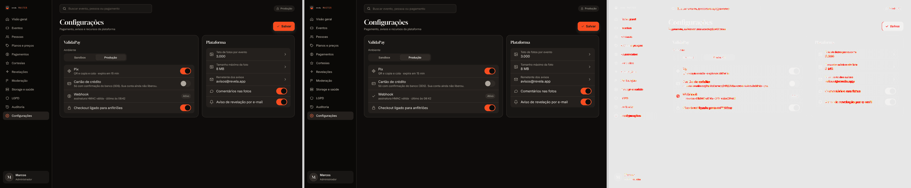

# Revela 2.0: fidelidade tela a tela

Referência (esquerda) | implementação com os dados do desenho (centro) | diferença pixelmatch (direita). 390×844; Master 1440×900. Geradas por `web/scripts/revela-evidence.mjs`.

| Tela | Título | HTML | Diff | Prova | Estado do markup | Ligação ao app |
|---|---|---|---|---|---|---|
| 00 | Splash | Abertura-splash | 6.38% |  | referência portada (dados do desenho) | não ligada ao app |
| 01 | Abertura com vídeo | Main | 15.18% |  | referência portada (dados do desenho) | não ligada ao app |
| 02 | Telefone | Cadastro-telefone | 0.93% |  | referência portada (dados do desenho) | não ligada ao app |
| 03 | Código | Cadastro-codigo | 0.42% |  | referência portada (dados do desenho) | não ligada ao app |
| 04 | Seu nome | Cadastro-perfil | 0.76% |  | referência portada (dados do desenho) | não ligada ao app |
| 05 | Para que vai usar | Cadastro-ocasiao | 1.51% |  | referência portada (dados do desenho) | não ligada ao app |
| 06 | Monte a câmera | Camera-montar | 3.25% |  | referência portada (dados do desenho) | não ligada ao app |
| 07 | Embalagem | Camera-embalagem | 10.44% |  | referência portada (dados do desenho) | não ligada ao app |
| 08 | Nome impresso | Camera-nome | 0.64% |  | referência portada (dados do desenho) | não ligada ao app |
| 09 | Até quando | Camera-data | 1.93% |  | portada e ligada a dados reais | passo 3 do assistente (`features/events/wizard.tsx`): dia, começa, termina; vira a meia-noite |
| 10 | Poses por pessoa | Camera-poses | 1.32% |  | portada e ligada a dados reais | passo 4: opções 10/24/27/36, legenda pelo catálogo; rolo da câmera é só visual (sem campo no evento) |
| 11 | Quando revelar | Camera-revelacao | 1.83% |  | portada e ligada a dados reais | passo 5: 4 opções calculadas no fuso do evento; bloqueia revelar antes do fim |
| 12 | Filme | Camera-filtro | 0.82% |  | referência portada (dados do desenho) | não ligada ao app |
| 13 | Quem vê o quê | Camera-privacidade | 0.99% |  | referência portada (dados do desenho) | não ligada ao app |
| 14 | Publicar | Camera-publicar | 1.59% |  | portada e ligada a dados reais | passo 8: planos do catálogo, pré-seleção pelas poses, aceites em diálogo "Antes de criar" |
| 15 | Câmera pronta | Camera-pronta | 4.07% |  | portada e ligada a dados reais | `/criar/pronto/[id]`: compartilhar convite (Web Share/cópia) e imprimir QR; código e link só em elemento oculto para teste |
| 14a | Resumo e forma de pagamento | Pagamento-resumo | 2.38% |  | portada e ligada a dados reais | `ValidaPayCheckout`: resumo, Pix/cartão (cartão só com publicId/flag), CPF/CNPJ extra no Pix (exigido pelo provedor; não está no desenho) |
| 14b | Pix | Pagamento-pix | 1.61% |  | portada e ligada a dados reais | `ValidaPayCheckout`: QR, contagem de expiração, copia e cola, polling |
| 14c | Cartão | Pagamento-cartao | 1.27% |  | portada e ligada a dados reais | `ValidaPayCheckout`: cartão tokenizado; telefone e endereço extras (exigidos pelo provedor; só com cartão ligado) |
| 14d | Confirmação do banco | Pagamento-3ds | 0.67% |  | portada e ligada a dados reais | `ValidaPayCheckout`: aguardando o banco (3DS) |
| 14e | Confirmando | Pagamento-processando | 7.75% |  | portada e ligada a dados reais | `ValidaPayCheckout`: confirmando/verificação; "Fechar e avisar depois" consulta o servidor |
| 14f | Pago | Pagamento-aprovado | 4.30% |  | portada e ligada a dados reais | `ValidaPayCheckout`: pago |
| 14g | Não deu certo | Pagamento-falhou | 1.08% |  | portada e ligada a dados reais | `ValidaPayCheckout`: recusado, expirado, indisponível, estornado |
| 14h | Trocar de plano | Pagamento-trocar-plano | 3.41% |  | portada e ligada a dados reais | `PlanPicker` (checkout nativo) em `/painel/[id]/plano` |
| 16 | Câmeras (anfitrião) | Anfitriao-inicio | 0.81% |  | portada e ligada a dados reais | `/eventos`: câmera em destaque + prateleira (criadas e convidadas); abas `HostTabs` |
| 17 | Ajustes do evento | Anfitriao-ajustes | 1.37% |  | referência portada (dados do desenho) | não ligada ao app |
| 17b | Convidados | Anfitriao-convidados | 1.39% |  | referência portada (dados do desenho) | não ligada ao app |
| 17c | Revisar antes de revelar | Anfitriao-moderar | 0.90% |  | referência portada (dados do desenho) | não ligada ao app |
| 17d | Resumo do evento | Painel-resumo | 1.17% |  | referência portada (dados do desenho) | não ligada ao app |
| 17e | Convites e mesas | Painel-convites | 2.71% |  | referência portada (dados do desenho) | não ligada ao app |
| 17f | Programação e local | Painel-programacao | 1.38% |  | referência portada (dados do desenho) | não ligada ao app |
| 17g | Aviso aos convidados | Painel-aviso | 1.60% |  | referência portada (dados do desenho) | não ligada ao app |
| 17h | Downloads | Painel-downloads | 1.57% |  | referência portada (dados do desenho) | não ligada ao app |
| 17i | Moderar comentários | Painel-moderacao | 1.93% |  | referência portada (dados do desenho) | não ligada ao app |
| 17j | Excluir evento | Painel-excluir | 1.20% |  | referência portada (dados do desenho) | não ligada ao app |
| 17k | Convite A5 para imprimir | Painel-convite-a5 | 0.77% |  | referência portada (dados do desenho) | não ligada ao app |
| 18 | Revelação | Revelados-galeria | 0.59% |  | referência portada (dados do desenho) | ligada: `/eventos/revelados` (e `/eventos/revelados/[id]`). Evento revelado mais recente do anfitrião; os 5 prints são destaques, depois os mais reagidos, depois os mais recentes; clicar abre o 19. Legenda com contagens reais e 'hoje/ontem/data, hh:mm'. 'Baixar tudo' leva a `/painel/[id]/downloads`. 'Ver como álbum' abre o 19b. Filtrar abre folha (por convidado e outro evento revelado; extra do desenho). Sem eventos: texto 'Nada revelado ainda.'. Eventos com revelação desligada contam como revelados. |
| 19 | Foto aberta | Revelados-foto | 0.26% |  | referência portada (dados do desenho) | ligada: `/eventos/revelados/[id]/[photoId]`. 'N de total' em ordem de captura. A estrela (aria 'Destacar') alterna 'Escolha dos noivos' (`moderate destacar`). Baixar = original; Compartilhar = Web Share com o arquivo, senão baixa. 'Mais' abre folha: quem reagiu, esconder/mostrar, remover com confirmação. Setas do teclado e deslize passam de foto; botões anterior/próxima só com dados reais (extra fora do fixture). |
| 19b | Álbum impresso | Revelados-album | 1.84% |  | referência portada (dados do desenho) | ligada: `/eventos/revelados/[id]/album`. Título, data e contagem reais; capas = 2 fotos do evento. Produtos e preços ('a definir') são os do desenho, fixos: não há backend de pedido/impressão. 'Escolher as fotos' leva a `/painel/[id]/conteudo` (destacar fotos); não inicia compra. |
| 20a | Leitura do QR | Convidado-qr | 0.25% |  | referência portada (dados do desenho) | não ligada ao app |
| 20b | Entrar no evento | Convidado-entrar | 1.27% |  | referência portada (dados do desenho) | não ligada ao app |
| 20c | Código do convite | Convidado-codigo | 0.89% |  | portada e ligada a dados reais | `/entrar` (código de 8 caixas) |
| 20d | Consentimento | Convidado-consentimento | 1.85% |  | referência portada (dados do desenho) | não ligada ao app |
| 20e | Convite inválido | Convidado-invalido | 0.87% |  | referência portada (dados do desenho) | não ligada ao app |
| 20f | Câmera lotada | Convidado-lotado | 0.90% |  | referência portada (dados do desenho) | não ligada ao app |
| 20g | Carregando a festa | Convidado-carregando | 5.25% |  | portada e ligada a dados reais | carregando a festa em `/e/[code]` (nome omitido até o convite carregar) |
| 20h | Código não confere | Convidado-codigo-erro | 1.39% |  | portada e ligada a dados reais | `/entrar?erro=` (código não confere) |
| 21 | Câmera | Convidado-camera | 0.07% |  | referência portada (dados do desenho) | não ligada ao app |
| 22 | Disparo | Convidado-flash | 0.07% |  | referência portada (dados do desenho) | não ligada ao app |
| 23 | Acesso à câmera | Convidado-permissao | 0.92% |  | referência portada (dados do desenho) | não ligada ao app |
| 24 | Filme acabou | Convidado-fim | 1.47% |  | referência portada (dados do desenho) | não ligada ao app |
| 23b | Feed antes da revelação | Convidado-laboratorio | 2.55% |  | portada e ligada a dados reais | `/e/[code]/agora` antes da revelação |
| 23c | Minhas poses | Convidado-minhas | 0.87% |  | portada e ligada a dados reais | `/e/[code]/minhas` |
| 23d | Enviar do rolo | Convidado-postar | 0.85% |  | portada e ligada a dados reais | sheet "Do rolo da câmera" em `/postar` |
| 23e | Editar foto | Convidado-editar | 0.89% |  | portada e ligada a dados reais | `/e/[code]/editar/[photoId]` |
| 23f | Programação | Convidado-programacao | 0.98% |  | portada e ligada a dados reais | `/e/[code]/programacao` |
| 23g | Você (convidado) | Convidado-voce | 1.48% |  | portada e ligada a dados reais | `/e/[code]/voce` |
| 24b | Aviso de revelação | Feed-aviso | 0.71% |  | referência portada (dados do desenho) | ligada: `/e/[code]/agora?aviso=1` (destino do toque na notificação do aparelho: `href` do aviso 'revelou'). Contagens reais; fundo = foto do evento; tocar leva ao 24c. Sem `?aviso=1` vai direto ao feed. Notificação continua a do navegador (melhor esforço, sem push real). |
| 24c | Revelou | Feed-revelou | 12.75% |  | referência portada (dados do desenho) | ligada: tela 'Revelou.' no momento da revelação com o app aberto (`RevealTransition` no layout do convidado) e depois do 24b. Hora da revelação, contagens e até 3 fotos reais (a sua com 'você'). 'Abrir o feed' fecha. Diff alto vem do confete (webp animado na referência). Substitui a transição escura antiga. |
| 24d | Feed do evento | Feed-evento | 0.39% |  | referência portada (dados do desenho) | ligada: `/e/[code]/agora` quando revelado (anfitrião sempre). Substitui `FeedAntigo`. Histórias = autores (filtram), 'pose N de M', curtir = reação Amei (alterna qualquer reação), tocar na foto abre 24f, comentar abre 24e, compartilhar (link do evento), baixar, 'Mais' (quem reagiu, editar, baixar, pedir para remover → 24g). Rolagem infinita de 20 em 20. Sino → 24i. Extras discretos sob o título: aviso do cerimonial, 'Revelação pendente' (anfitrião), 'Ver a retrospectiva' (evento encerrado); 'Crie o seu' ao fim. Botão 'Abrir câmera' do feed antigo saiu (câmera na aba Minhas). |
| 24e | Comentários | Feed-comentarios | 1.83% |  | referência portada (dados do desenho) | ligada: folha sobre o feed e sobre a foto aberta, com `post_comment`, `list_photo_comments`, `comment_counts`, `toggle_comment_like`, `delete_my_comment`; MM016/MM017/MM018/MM004/MM005/MM006 viram texto. 'Responder' preenche '@Nome ' (não há resposta aninhada no banco). Extras junto do 'Responder': 'Denunciar' (→ 24g, `report_comment`) e 'Apagar' (o seu). Modo local: comentários no aparelho com as mesmas regras. |
| 24f | Reações | Feed-reacoes | 0.42% |  | referência portada (dados do desenho) | ligada: foto aberta a partir do feed (overlay), 'N de total' do feed filtrado, 4 reações com contagem e a minha marcada (`react`), comentar → 24e, baixar, 'Mais'. Anterior/próxima e setas do teclado são extra fora do fixture. |
| 24g | Denunciar | Feed-denunciar | 1.38% |  | referência portada (dados do desenho) | ligada: 'Pedir para remover' da folha 'Mais opções' abre esta tela (`report_photo`); 'Denunciar' do comentário usa `report_comment` (3 denúncias escondem). Divergência: o motivo escolhido não é gravado (as RPCs não têm coluna de motivo). Para comentário os 2 primeiros motivos mudam ('Ofensivo ou desrespeitoso', 'Spam ou propaganda'). Estado 'Denúncia enviada' no lugar do botão. |
| 24h | Retrospectiva | Feed-retrospectiva | 4.06% |  | referência portada (dados do desenho) | ligada: `/e/[code]/retrospectiva` (aviso discreto 'Ver a retrospectiva' no feed de evento encerrado; anfitrião sempre). Números reais: fotógrafos, reações, pico de 10 min com o momento mais fotografado, fotos por hora (até 8 mais cheias) e top 3 ('n/rolo'). Diff de 4% = referência com ~15 px a mais entre carimbo e título (webp antigo); markup igual ao HTML. 'Ver todas em Explorar' saiu. |
| 24i | Aviso por e-mail | Feed-email | 2.15% |  | referência portada (dados do desenho) | ligada: `/e/[code]/aviso-email` (sino do feed). E-mail que a pessoa recebe, com nome, contagens e fotos reais, e folha 'Aviso por e-mail' para deixar/trocar/remover (`set_my_email`, `get_my_email`, `email_opt_out_mine`). Sublinhado 'Não quero mais avisos' também sai da lista. Modo local: folha avisa que não há envio. Consentimento = informar o e-mail com a finalidade escrita (regra do 20b). A folha é extra fora do desenho. |
| 24j | Sair dos avisos por e-mail | Feed-email-sair | 1.01% |  | referência portada (dados do desenho) | ligada: página pública `/email/sair?t=<token>` (link de `reveal-emails`). Lê título/código/e-mail e já sai (`email_opt_out`); 'Abrir o feed' → `/e/[code]`; 'Voltar a receber' reativa (`email_resubscribe`). Migration aditiva `20261109000600` (`email_opt_out_preview`, `email_resubscribe`) + pgTAP 29. Decisão: sair é imediato ao abrir o link, reversível. Token inválido, sem servidor ou falha de rede usam o mesmo layout com texto próprio. |
| 25 | QR para as mesas | QR-convite | 1.24% |  | referência portada (dados do desenho) | não ligada ao app |
| 26 | Compartilhar | QR-compartilhar | 0.61% |  | referência portada (dados do desenho) | não ligada ao app |
| 27 | Você | Voce | 1.36% |  | portada e ligada a dados reais | `/eventos/voce`: conta, extras e ajuda; "Nome e foto", "Telefone" e "Ícone do app" só informativos (conta Google, sem campo no produto) |
| 28 | Sem internet | Apoio-offline | 0.60% |  | referência portada (dados do desenho) | não ligada ao app |
| 29 | Excluir conta | Apoio-excluir-conta | 1.30% |  | referência portada (dados do desenho) | não ligada ao app |
| 30 | Preços | Apoio-precos | 1.97% |  | referência portada (dados do desenho) | não ligada ao app |
| 31 | Termos e privacidade | Apoio-termos | 5.69% |  | referência portada (dados do desenho) | não ligada ao app |
| 32 | Ajuda | Apoio-ajuda | 2.46% |  | referência portada (dados do desenho) | não ligada ao app |
| M00 | Login | Master-login | 0.19% |  | referência portada (dados do desenho) | não ligada ao app |
| M01 | Visão geral | Master-visao | 0.84% |  | referência portada (dados do desenho) | não ligada ao app |
| M02 | Eventos | Master-eventos | 1.34% |  | referência portada (dados do desenho) | não ligada ao app |
| M03 | Planos e preços | Master-planos | 1.27% |  | referência portada (dados do desenho) | não ligada ao app |
| M04 | Confirmar novo preço | Master-plano-publicar | 0.79% |  | referência portada (dados do desenho) | não ligada ao app |
| M05 | Pagamentos | Master-pagamentos | 1.35% |  | referência portada (dados do desenho) | não ligada ao app |
| M06 | Detalhe do pagamento | Master-pagamento-detalhe | 1.31% |  | referência portada (dados do desenho) | não ligada ao app |
| M07 | Cortesias | Master-cortesias | 0.83% |  | referência portada (dados do desenho) | não ligada ao app |
| M08 | Revelações | Master-revelacoes | 1.28% |  | referência portada (dados do desenho) | não ligada ao app |
| M09 | Moderação | Master-moderacao | 0.90% |  | referência portada (dados do desenho) | não ligada ao app |
| M10 | Pessoas | Master-pessoas | 1.06% |  | referência portada (dados do desenho) | não ligada ao app |
| M11 | Storage e saúde | Master-saude | 0.82% |  | referência portada (dados do desenho) | não ligada ao app |
| M12 | LGPD | Master-lgpd | 0.82% |  | referência portada (dados do desenho) | não ligada ao app |
| M13 | Auditoria | Master-auditoria | 1.16% |  | referência portada (dados do desenho) | não ligada ao app |
| M14 | Configurações | Master-config | 1.02% |  | referência portada (dados do desenho) | não ligada ao app |
