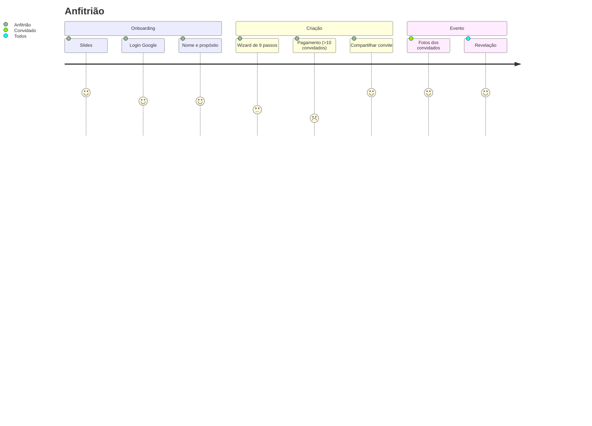

# 04 — Jornadas de usuário

## J-1 Anfitrião: do zero ao evento ativo (EST; início OBS)
1. Abre o app → 3 slides (OBS) → Boas-vindas.
2. Entra com Google (única via ativa) → informa nome → escolhe propósito → Home vazia ("Crie um novo evento").
3. "Criar evento": notificações → nome → categoria → término (≥30 min no futuro) → revelação → estilo de câmera → convite (capa/preview) → convidados e fotos/pessoa → preço.
4. Se ≤10 convidados: "Criar evento grátis". Senão: "Pagar X e criar" (Play) ou Memo+.
5. "Evento criado!": copia código/link, compartilha convite (texto + link) ou mostra QR.
6. Abre a câmera ou fecha; Home passa a mostrar o hero do evento ativo.
7. Durante o evento: notificação persistente com rolo restante; ao fim, notificações de encerramento e revelação.
8. Após término/revelação: álbum aparece em ÁLBUNS; host pode salvar/compartilhar/excluir.

## J-2 Convidado por link/código (EST)
1. Abre `https://appmemo.online/ABCDEFGH` ou digita o código na tela inicial ("Convidado? Entre com um código").
2. Sessão anônima é criada; `resolve_event_by_code` valida; tela de convite mostra capa, "Convidado por {host}" e campo "Digite seu nome".
3. `join_event(code, guest_name)` → participa. Erros: código inexistente, evento encerrado, evento lotado, não autenticado.
4. Abre câmera, tira fotos até esgotar o rolo; as fotos não aparecem durante o evento (conforme modo de revelação).
5. Na revelação recebe notificação, abre o álbum, reage, edita, salva.

## J-3 Capturar um momento (EST)
Câmera aberta → permissão de câmera (negada: placeholder + Pedir de novo/Abrir configurações) → disparo → filtro de estilo aplicado → gravação local (`.jpg`) → entra na fila pendente → upload ao Storage + insert em `photos` → se servidor recusa por limite: foto removida do rolo e aviso.

## J-4 Rever e salvar o álbum (EST)
Home → álbum → grade (fotos não reveladas com marca) → foto → reagir/ver quem reagiu → Editar (desenho/texto/colagem) → Salvar → `Pictures/Memo` com relatório (salvas / não baixaram / ausentes / recusadas pela galeria).

## J-5 Gerenciar evento (host) (EST)
Galeria → engrenagem → alterar nome/capa, adiar/encerrar, mudar revelação, capacidade, fotos/pessoa, visibilidade, reações → ou excluir (apaga fotos e reações; falha remota avisa). Regra: álbum já encerrado e com fotos **não reabre**.

## J-6 Assinar Memo+ (EST)
Perfil ou tela de preço → paywall → plano anual/mensal → Google Play → assinatura ativa; "Restaurar compras" reconcilia; eventos criados permanecem para sempre.

## J-7 Sair/excluir conta (EST)
Perfil → "Sair da conta?" (volta ao onboarding; álbuns locais permanecem) ou "Excluir sua conta?" (RPC `delete_account`; remove eventos do usuário e fotos para todos).

## Diagrama (Mermaid) — ver também `diagrams/user-journeys.md`

