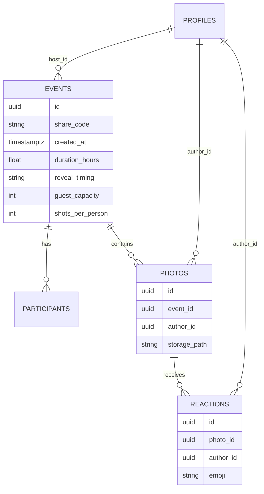

# 08 — Modelo de dados preliminar

Fonte: `Backend/*Row.kt` (nomes de colunas reais, `@SerialName`), `Domain/*`. **Tabelas do Supabase NÃO foram criadas.** Tipos SQL são **inferência** (INF) a partir de tipos Kotlin; constraints/RLS não são visíveis.

## Entidades
### profiles (EST: `from("profiles")`)
`id uuid = auth.uid`, `name text` — nome de exibição.

### events (EventRow, EST)
| Coluna | Tipo (INF) | Notas |
|---|---|---|
| id | uuid/text | gerado no cliente (`UUID.randomUUID()`) |
| host_id | uuid → auth.users | dono |
| host_name | text | |
| title | text | ex. "Casamento de {host}" |
| category | text | MemoPurpose (casamento, empresa, viagem, festa, outro, …) |
| share_code | text(8) | alfabeto `23456789ABCDEFGHJKMNPQRSTUVWXYZ`, único (INF) |
| created_at | timestamptz | início do evento |
| duration_hours | double | **fim = created_at + duration_hours·3600000 ms** |
| camera_style | text enum | ORIGINAL \| VINTAGE \| BLACK_WHITE |
| reveal_timing | text enum | DURING_EVENT \| AFTER_EVENT \| ADDITIONAL_DELAY |
| reveal_delay_days | int | usado com ADDITIONAL_DELAY |
| guest_capacity | int | 5,10,20,50,100,150,200, ilimitado (sentinela alto) |
| shots_per_person | int null | 5,10,16,24,36; null/0 = ilimitado |
| everyone_can_see_all_photos | bool | |
| reactions_enabled | bool | |
| cover_image | text | `generic_cover_N`, `photo_party`, `photo_toast`, `custom:<path>` ou caminho `covers/<…>` no Storage |

### participants (ParticipantRow, EST)
`event_id`, `user_id`, `name`. Criada por RPC `join_event` (guest_name). `fetchParticipantKeys` lê participantes do evento.

### photos (PhotoRow, EST)
`id`, `event_id`, `author_id`, `author_name`, `file_name`, `storage_path`, `created_at`. Arquivo binário no bucket **`event-photos`** (caminho `defaultStoragePath`/`remoteStoragePath`).

### reactions (ReactionRow, EST)
`id`, `event_id`, `photo_id`, `author_id`, `author_name`, `emoji` (🔥 ❤️ 😂 😮), `created_at`. **Unique (photo_id, author_id)** → `upsert(on_conflict = "photo_id,author_id")`.

### Locais (cliente)
`events.json` (eventos+fotos+reações), `PendingSyncStore` (ids pendentes de evento/foto/reação), `OnboardingStore` (nome, propósito, exemplo semeado, notificações), créditos de compra (`credit_<sku>`, tokens processados), sessão.

## ERD (Mermaid)

## Regras e ciclo de vida
- **Fim do evento:** `end = created_at + duration_hours`. Mínimo 30 min no futuro ao criar. Edição de término: Encerrar agora / fim de hoje / amanhã / +3 / +7 / +30 dias; **não reabrir álbum encerrado com fotos**.
- **Revelação:** `DURING_EVENT` (fotos aparecem aos poucos); `AFTER_EVENT` (ao encerrar); `ADDITIONAL_DELAY` (encerrar + N dias).
- **Entrada:** valida código; falhas `codenotfound`, `eventended`, `eventfull`, `notauthenticated`. Capacidade ≤ guest_capacity.
- **Rolo:** `shots_per_person` por (evento, usuário), imposto no servidor (`shotlimitreached`).
- **Exclusão de evento:** apaga fotos (binários no Storage), reações, participantes e capa; falha remota deixa evento "continua com quem participou". **Excluir conta:** RPC `delete_account` (eventos do usuário e fotos).
- **Capa:** upload para `covers/`; se offline, "vale neste aparelho" até subir.
- **Preço (INF/EST):** créditos de compra por faixa de convidados, consumidos na criação (`PurchaseCredits.consume`); Memo+ dispensa pagamento até 200 convidados.
- **Autenticação:** Supabase Auth — Google ID token; anônima para convidados; e-mail/senha inativo na UI. Sessão persistida cifrada.
- **Armazenamento de arquivos:** Storage bucket `event-photos` (fotos e capas `covers/`); fotos locais `.jpg` em diretório interno; export em `Pictures/Memo`.
- **Validações:** código 8 chars maiúsculo; nome obrigatório (INF); senha ≥6.
