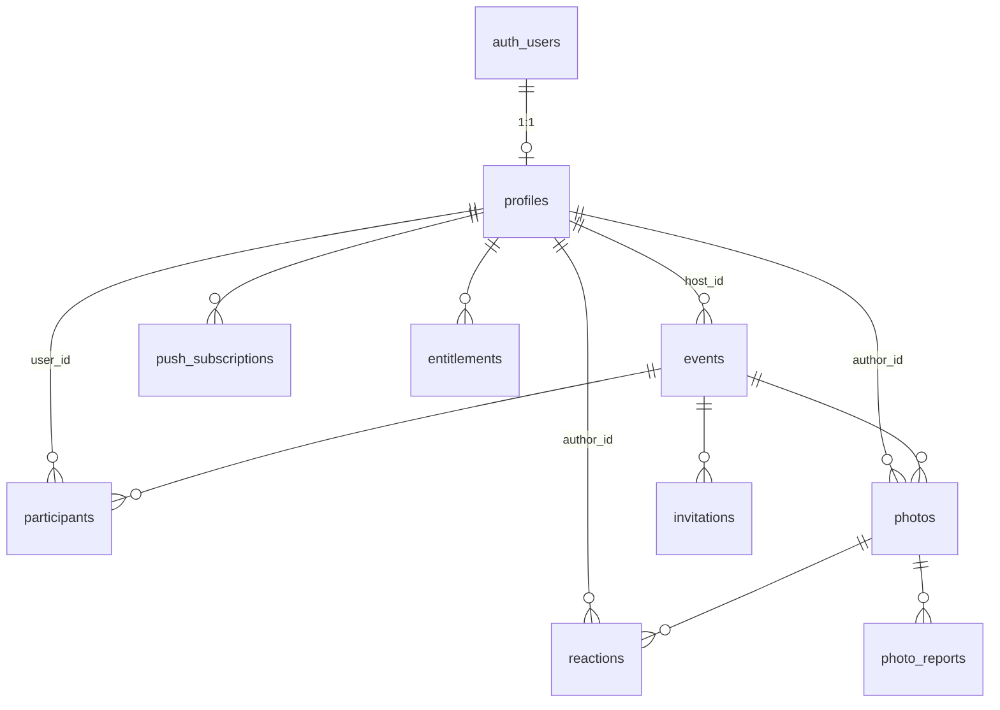

# Plano de integração Supabase (NÃO executado)

Status: **somente planejamento.** Nada foi criado no Supabase: sem projeto, sem credenciais, sem buckets, sem migrations, sem Auth. A aplicação atual usa repositórios locais atrás de interfaces; este plano diz como trocá-las.
Fontes: `docs/reverse-engineering/08-DATA-MODEL.md` e `09-API-AND-INTEGRATIONS.md` (REA), `web/src/repositories/types.ts`, `web/src/domain/*`.
Convenção: **[REA]** confirmado pelo REA · **[DEC]** decisão deste plano · **[HIP]** hipótese a validar.

## 0. Revisão pós-AUD-001 (v2): o que mudou e por quê
Fonte: `docs/audit/08-SUPABASE-READINESS.md` (A4) e `docs/audit/drafts/A3.md`. Decisões técnicas adotadas (reversíveis) e propostas de produto (aguardam confirmação do dono) estão em `docs/supabase/DECISIONS.md`.
| Contradição/lacuna do plano v1 | Decisão v2 |
|---|---|
| §4.1 dizia que nem o autor lê a própria foto antes da revelação; §5 dizia "autor: as suas" | **Ninguém que não seja o host lê foto antes de `is_revealed`, nem o autor** (câmera descartável; é o que a interface faz). Tabela de RLS corrigida |
| `reveal_status` espelhado por qualquer cliente | **Só a tarefa `reveal_due_events` escreve** `reveal_status` e `revealed_at`; a RLS usa `now() >= reveal_at OR revealed_at IS NOT NULL`, não o espelho. O cliente apenas lê |
| Revelação "ao terminar" gravada como data absoluta | `reveal_anchor` (`fim`/`data`) e `reveal_offset_days`: o servidor recalcula `reveal_at` quando o fim muda e a revelação ainda não ocorreu (BG-101) |
| `participants` × `event_members` | **`participants`**; host fora da tabela; `is_member = is_host OR participants` |
| `invitations` sem uso | O link carrega `invitations.id`; `participants.invitation_id` registra a origem; `?mesa=` deixa de ser rótulo livre confiável |
| `photos.author_id not null` impede importar fotos de convidados | `author_id` nullable (`on delete set null`), `author_name` preservado |
| Importação bloqueada pelos triggers de evento encerrado | RPC `import_event` `security definer` com bypass controlado e idempotente por UUID |
| Rolo contado no cliente | RPC `my_shot_count(event_id)` + trigger `before insert` (a verdade); o cliente só exibe |
| Sem controle de concorrência | `version` e `updated_at` em `events` e `photos`; `update … where version = $expected` → conflito tipado |
| Sem paginação/contagem | `photos`/`participants` expõem `count`, páginas por cursor; PostgREST trunca em 1000 linhas |
| Upload em um passo | duas fases: linha `enviando` → objeto → `finalize_photo` → `pronta`; `created_at` pelo servidor, `captured_at` do cliente |
**RPCs adicionais:** `event_preview(code)` (campos mínimos do convite, sem participantes nem fotos), `my_shot_count(event_id)`, `import_event(bundle)`, `finalize_photo(photo_id)`, além de `join_event`, `get_photo_url`, `delete_account`.


## 1. Contratos que já existem no código (não mudam)
| Interface local | Implementação atual | Implementação Supabase |
|---|---|---|
| `EventRepository` | IndexedDB | tabela `events` + RPC `resolve_event_by_code` |
| `ParticipantRepository` | IndexedDB | tabela `participants` + RPC `join_event` |
| `PhotoRepository` | IndexedDB (bytes em `photoData`) | tabela `photos` + Storage `event-photos` |
| `ReactionRepository` | IndexedDB | tabela `reactions` (PK `photo_id, author_id`) |
| `InvitationRepository` | IndexedDB | tabela `invitations` |
| `UserRepository` / `AuthService` | identidade local | Supabase Auth |
| `BillingService` | `localBilling` (nunca cobra) | gateway + `entitlements` (§9) |
| `NotificationScheduler` | `setTimeout` com app aberto | Web Push + Edge Function (§8) |
Regras puras (`domain/*`) continuam no cliente **e** são reaplicadas no banco (§4), porque o cliente não é confiável.

## 2. ERD proposto


## 3. Esquema (rascunho de DDL; tipos inferidos do REA e do domínio local)
```sql
create type reveal_status as enum ('desativada','pendente','revelada');          -- [DEC] espelho persistido; a verdade é now() >= reveal_at
create type camera_style  as enum ('original','vintage','preto-e-branco');      -- [REA]
create type event_category as enum ('casamento','festa','empresa','viagem','outro'); -- [REA] MemoPurpose
create type photo_status  as enum ('visivel','oculta','removida');
create type reaction_kind as enum ('amei','esse-momento','risada','uau');       -- [DEC] rótulos do kit; 4 tipos [REA]

create table profiles (id uuid primary key references auth.users on delete cascade, name text not null check (length(trim(name)) between 1 and 40), created_at timestamptz default now());

create table events (
  id uuid primary key default gen_random_uuid(),
  code text not null unique check (code ~ '^[23456789ABCDEFGHJKMNPQRSTUVWXYZ]{8}$'),   -- [REA]
  host_id uuid not null references profiles on delete cascade,
  title text not null check (length(trim(title)) between 1 and 60),
  category event_category not null,
  start_at timestamptz not null default now(),
  duration_hours numeric not null check (duration_hours >= 0.5),                      -- [REA] mínimo 30 min
  ended_at timestamptz,                                                                -- "encerrar agora"
  camera_style camera_style not null default 'original',
  reveal_enabled boolean not null default true,                                        -- [DEC] desligada = fotos visíveis na hora
  reveal_at timestamptz,                                                                -- UTC; obrigatório quando reveal_enabled
  timezone text not null default 'America/Cuiaba',                                      -- IANA: só para exibir e contar no fuso do evento
  reveal_status reveal_status not null default 'pendente',                              -- espelho; escrito SÓ pela tarefa reveal_due_events
  revealed_at timestamptz,                                                              -- monotônico: gravado uma vez (= reveal_at), nunca volta a null (BG-102)
  reveal_anchor text not null default 'fim' check (reveal_anchor in ('fim','data')),   -- BG-101: 'fim' acompanha o fim do evento
  reveal_offset_days int not null default 0 check (reveal_offset_days between 0 and 30),
  version int not null default 1, updated_at timestamptz not null default now(),         -- concorrência otimista (ITG-102)
  constraint reveal_consistente check ((reveal_enabled and reveal_at is not null) or (not reveal_enabled and reveal_at is null)),
  capacity int check (capacity in (5,10,20,50,100,150,200)),                           -- null = ilimitado [REA]
  shots_per_person int check (shots_per_person in (5,10,16,24,36)),                    -- null = ilimitado [REA]
  everyone_sees_all boolean not null default true,
  reactions_enabled boolean not null default true,
  palette text not null default 'salvia', event_font text not null default 'birthstone',
  place text, moments text[] not null default '{}', tables int not null default 0,
  notice jsonb, created_at timestamptz not null default now(), updated_at timestamptz not null default now()
);
create table participants (event_id uuid references events on delete cascade, user_id uuid references profiles on delete cascade, name text not null, table_label text, joined_at timestamptz default now(), primary key (event_id, user_id));
-- participants.invitation_id uuid references invitations (origem da entrada, ex.: Mesa 8); host NÃO é linha em participants: is_member = is_host OR existe participants
create table photos (
  id uuid primary key,                         -- gerado no cliente: idempotência do envio offline
  event_id uuid not null references events on delete cascade, author_id uuid references profiles on delete set null,  -- nullable: importação de fotos de autores sem conta; author_name sempre preenchido
  captured_at timestamptz, upload_status text not null default 'pronta' check (upload_status in ('enviando','pronta','falhou')), mime text, bytes int, width int, height int, deleted_at timestamptz, version int not null default 1,
  author_name text not null, moment text not null, caption text check (length(caption) <= 140), table_label text,
  status photo_status not null default 'visivel', highlighted boolean not null default false,
  storage_path text not null unique, created_at timestamptz not null default now()
);
create table photo_reports (photo_id uuid references photos on delete cascade, reporter_id uuid references profiles on delete cascade, created_at timestamptz default now(), primary key (photo_id, reporter_id));
create table reactions (photo_id uuid references photos on delete cascade, author_id uuid references profiles on delete cascade, event_id uuid not null references events on delete cascade, kind reaction_kind not null, primary key (photo_id, author_id));  -- [REA] upsert on (photo_id, author_id)
create table invitations (id uuid primary key default gen_random_uuid(), event_id uuid references events on delete cascade, label text not null, expires_at timestamptz, revoked_at timestamptz, created_at timestamptz default now());  -- o link carrega o id (não o rótulo livre): ITG-107
create table push_subscriptions (id uuid primary key default gen_random_uuid(), user_id uuid references profiles on delete cascade, event_id uuid references events on delete cascade, endpoint text not null unique, p256dh text not null, auth text not null);
create table entitlements (user_id uuid references profiles on delete cascade, kind text not null, capacity int, valid_until timestamptz, provider_ref text not null unique, primary key (user_id, provider_ref));
create index on photos (event_id, created_at desc); create index on participants (user_id); create index on reactions (event_id);
```
Contagem de pedidos de remoção = `count(*) from photo_reports` (evita contar duas vezes a mesma pessoa; o cliente local usa um contador simples).

## 4. Regras no servidor (espelham o domínio)
- **`resolve_event_by_code(code)`** `security definer`: devolve só `title, category, host name, place, palette, event_font, start/end, status`. Sem lista de participantes. [REA E-06]
- **`join_event(code, guest_name, table_label)`** `security definer`: exige `auth.uid()` (sessão anônima conta); erros `codenotfound`, `eventended`, `eventfull`, `notauthenticated` [REA]; idempotente para quem já é membro; capacidade contada **dentro da transação** (`select … for update` no evento) para não estourar sob concorrência.
- **Limite de fotos**: trigger `before insert on photos` conta fotos não removidas do autor no evento e levanta `shotlimitreached` [REA E-15]; também bloqueia evento encerrado (`now() >= least(ended_at, start_at + duration_hours)`).
- **Revelação**: função `is_revealed(event)` = `not reveal_enabled or now() >= reveal_at`. Usada nas policies; o horário é o do servidor, nunca o relógio do cliente. Ver §4.1.
- **Reação única**: PK `(photo_id, author_id)` + `upsert`.
- **Não reabrir álbum encerrado com fotos**: trigger em `update events` bloqueia aumentar `duration_hours`/limpar `ended_at` se encerrado e há fotos. [REA F-36]
- **Exclusão de evento** em cascata (fotos, reações, participantes, convites) + remoção de objetos do Storage por Edge Function (`on delete`/job), porque o Postgres não apaga objetos sozinho. [REA E-S]
- **`delete_account()`** `security definer`: apaga perfil, eventos que organiza e fotos; mantém reações/fotos de terceiros só se a política LGPD decidir (por padrão apaga as do usuário). [REA E-04]

## 4.1 Revelação programada no servidor (contrato já modelado no cliente)
Cliente hoje: `reveal_enabled`, `reveal_at`, `timezone`, `reveal_status` em `MemoEvent`; `computeRevealStatus(now)` decide a visibilidade; `reconcileReveal` espelha o estado de forma idempotente; os timers do navegador só acordam a interface. **Nada disso é segurança**: no cliente a foto bloqueada existe no aparelho. No servidor:
- **Quem configura**: só o organizador do evento (`is_host`) ou master com auditoria (`audit_logs`). Trigger recusa `update` de `reveal_*` quando `reveal_status = 'revelada'` (não esconder o que já foi visto) e recusa ligar a revelação se já existem fotos visíveis. `reveal_at` precisa estar ≥ `now() + 1 min` na gravação.
- **Revelação idempotente**: `pg_cron` a cada minuto executa `reveal_due_events()`: `update events set reveal_status='revelada', revealed_at = reveal_at where reveal_enabled and revealed_at is null and reveal_at <= now()` (idempotente, sem efeito se repetido) e publica via Realtime (`events` canal por `event_id`) e Web Push ("As fotos foram reveladas"). Se o job atrasar, a RLS continua correta porque ela usa `now() >= reveal_at`, não o status.
- **Controle de acesso das fotos**: a policy de `photos` só devolve linha a não-host se `is_revealed(event)`; o bucket `event-photos` é **privado** e o cliente só obtém **URL assinada** (curta, 60 s) por RPC `get_photo_url(photo_id)` que reaplica a mesma regra. Antes da revelação nem a linha nem o objeto são acessíveis, nem para o autor (câmera descartável); o host vê tudo para moderar.
- **Sincronização entre dispositivos**: o cliente assina o canal do evento; ao receber `reveal_status = 'revelada'` roda a transição. Offline: ao reconectar, relê `events` e recalcula; nunca confia em contagem local.
- **Fuso**: `reveal_at` é sempre UTC; `timezone` só formata. Alterar o fuso sem mudar a hora de parede recalcula `reveal_at` no cliente e grava o novo UTC.
- **Papéis**: `profiles.role` não existe no cliente; `master` vem de claim `app_metadata.role` emitida só pelo servidor. Ver `docs/architecture/ROLES.md`.
- **Testes de backend a escrever**: convidado não lê foto antes de `reveal_at` (linha e objeto); URL assinada recusa antes; job idempotente sob repetição; organizador de outro evento não altera `reveal_*`; edição após revelada recusada; relógio do cliente adiantado não adianta a revelação.

## 5. RLS (todas as tabelas com RLS ligado; nenhuma policy `using (true)`)
| Tabela | select | insert | update | delete |
|---|---|---|---|---|
| `profiles` | próprio perfil; nome visível a co-participantes | no signup (trigger) | próprio | só via `delete_account` |
| `events` | host, ou participante (colunas completas); público só via RPC | host (`host_id = auth.uid()`) | host | host |
| `participants` | host vê todos; participante vê os do mesmo evento | só via `join_event` | próprio nome/mesa | host remove; próprio sai |
| `photos` | host: todas não removidas (moderação). **Convidado, inclusive o autor, só lê depois de `is_revealed`** (contradição corrigida: antes constava "autor: as suas"); `status='visivel' and upload_status='pronta'`; `everyone_sees_all=false` limita a si mesmo, mas só depois da revelação | membro, `author_id = auth.uid()`, passa nos triggers | host (`status`, `highlighted`) com `version` | host (soft delete) |
| `reactions` | membros do evento (se reações ligadas) | membro, `author_id = auth.uid()`, só em foto que enxerga | próprio | próprio |
| `photo_reports` | host | membro (uma por foto) | — | — |
| `invitations`, `push_subscriptions`, `entitlements` | host / próprio / próprio | host / próprio / só service role | — | host / próprio / — |
Helper `is_member(event_id)`/`is_host(event_id)` com `security definer` e `search_path` fixo. **Testes de RLS** (pgTAP ou script com dois usuários): convidado A não lê foto de B antes da revelação; B não escreve com `author_id` de A; usuário de fora não lê nada; host lê tudo. Isolamento entre eventos é o teste mais importante (aprendizado APR-035 do projeto Express: vínculo nunca vem do corpo da requisição).

## 6. Auth
- Convidado: **sign-in anônimo** (`signInAnonymously`) ao abrir o convite [REA E-05]; ao postar com nome, grava `profiles`. Opção de "salvar minha conta" com `linkIdentity` (Google) mantendo o mesmo `user.id` e as fotos.
- Anfitrião: **Google OAuth** (client ID próprio na web). E-mail/senha **não** (inativo no original; sem evidência). [REA F-03/F-04]
- Sessão em cookies/`localStorage` gerenciados pelo `supabase-js`; o app continua funcionando com identidade local até o login (migração em §10).
- Proteções: rate limit nativo do Auth, CAPTCHA (Turnstile) no sign-in anônimo para conter abuso (aprendizado do projeto `memo-brasil`).

## 7. Storage e fotos
- Bucket **privado** `event-photos`; caminho `{event_id}/{photo_id}.jpg` (e `covers/` se houver capa por imagem).
- Policies por membership: `insert` só em `{event_id}/…` de evento em que é membro e o `photo_id` precisa existir na linha de `photos` já inserida (ordem: linha → objeto, ou RPC que cria os dois); `select` via **URL assinada** de curta duração emitida só para quem passa nas regras da §5.
- Limites: 8 MB/objeto, tipos `image/jpeg|png|webp`; remoção de EXIF/GPS no cliente antes do upload (o `renderPhoto` já reencoda no canvas, que descarta EXIF) e **validar tipo por conteúdo** no servidor (aprendizado APR-029/PR #14).
- Miniaturas: transformação de imagem do Supabase ou geração no upload (Edge Function) para o Explorar.

## 8. Tempo real e notificações
- **Realtime** (`postgres_changes`) em `photos`, `reactions` e `events.notice`, filtrado por `event_id` e sujeito à RLS (o Realtime respeita as policies). Presença opcional para "ao vivo".
- Cliente: manter o feed local como cache e **mesclar** eventos recebidos por `photo.id` (idempotente).
- **Push**: Web Push (VAPID) com `push_subscriptions`; agendamento por `pg_cron` + Edge Function que usa `notificationPlan` (mesmo cálculo do cliente, portado). iOS só em PWA instalada ≥16.4. Hoje o app só agenda enquanto aberto.

## 9. Pagamentos (fora do escopo desta fase; decisão pendente)
Gateway (Stripe/Pix) com **webhook** assinado → grava `entitlements`; `create event` valida `priceRule` no servidor (≤10 grátis; ≤200 com Memo+; senão exige entitlement de evento). **Nunca** confiar em compra reportada pelo cliente (o app Android original parece validar só no cliente: [HIP], risco registrado no REA).

## 10. Migração dos dados locais
1. Ao primeiro login, o app oferece "Levar meus eventos para a nuvem" **somente para eventos que o usuário organiza**.
2. Exporta do IndexedDB (JSON + blobs) e envia em lote **idempotente** (mesmos UUIDs): `events` (novo `host_id = auth.uid()`; o `code` local é mantido se livre, senão regenerado e o QR reimpresso), `photos` (+ upload), `reactions` e `participants` **não** migram (pessoas locais não têm conta; as reações ficam como história local).
3. Dados de convidado em outro aparelho nunca existiram no servidor; não há o que reconciliar. Eventos de exemplo (`seedDemoEvent`) são descartados.
4. Rollback: nada é apagado localmente até o usuário confirmar; exclusão local só depois de contagem igual (fotos enviadas = fotos locais).

## 11. Sincronização e conflitos
- **Outbox** em IndexedDB (equivalente ao `PendingSyncCoordinator` do Android) para ações offline: `photo.add`, `reaction.set`, `report`. Reenvio com backoff; falha permanente de limite (`shotlimitreached`) remove a foto do rolo local com aviso (REA F-28).
- Fotos: **somente inserção**, `id` do cliente ⇒ reenvio seguro. Reações: upsert por PK ⇒ última escrita vence. Moderação/configurações do host: `updated_at` + *last-write-wins* com `If-Match` (rejeita se versão antiga e pede recarregar). Exclusões: soft delete (`removida`) propaga; hard delete só no evento.
- Relógio: revelação/encerramento decididos **no servidor**; o cliente só exibe. Diferença de relógio ≤ 1 min tolerada no contador; fonte de verdade é `now()` do banco.

## 12. Passos de execução (quando autorizado)
1. Criar projeto Supabase (região `sa-east-1`), habilitar anonymous sign-ins e Google. 2. Aplicar DDL como migrations versionadas (`supabase/migrations`). 3. Escrever e rodar testes de RLS. 4. Implementar `Supabase*Repository` + `SupabaseAuthService` atrás das interfaces e um flag de ambiente; manter `Local*` para testes. 5. Outbox + realtime. 6. Migração local→nuvem. 7. Push. 8. Pagamentos. 9. Só então publicar em produção.
Variáveis (nomes apenas; **sem valores no repositório**): `NEXT_PUBLIC_SUPABASE_URL`, `NEXT_PUBLIC_SUPABASE_ANON_KEY`, `SUPABASE_SERVICE_ROLE_KEY` (somente servidor), `VAPID_PUBLIC_KEY`/`VAPID_PRIVATE_KEY`.
